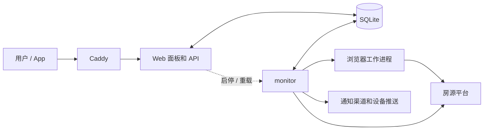
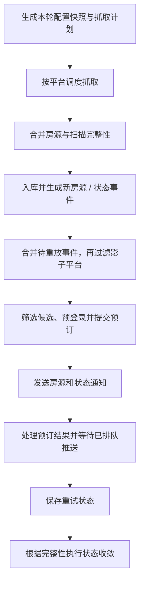

# FlatRadar 架构总览

本文面向维护者，介绍当前代码的进程模型、数据流、配置机制和故障处理边界。本文不
代表实际部署状态或第三方平台的实时行为；维护者需要分别核实这些信息。具体实现以
相关代码为准。

- 日常使用和部署：[中文 README](README_cn.md) / [English README](README.md)、[使用指南](https://flatradar.app/guide?lang=zh)
- API 契约：[API.md](API.md) / [openapi.json](openapi.json)
- 平台细节：[H2S.md](H2S.md)、[H2S_BOOKING_OPS.md](H2S_BOOKING_OPS.md)、[RENTCAFE.md](RENTCAFE.md)、[XIOR.md](XIOR.md)、[OURDOMAIN.md](OURDOMAIN.md)、[PLAZA.md](PLAZA.md)、[SCRAPING_RECON.md](SCRAPING_RECON.md)
- 后续工作：[FUTURE_PLAN.md](FUTURE_PLAN.md)；版本历史：[CHANGELOG.md](CHANGELOG.md)

## 进程与存储

在标准 Docker 部署中，Caddy 容器提供 HTTPS 和反向代理，应用容器内的 supervisord
管理 Web 和 monitor 两个独立进程。Web 提供管理面板和 API；monitor 负责周期性抓取
房源并处理抓取结果。两个进程共享 SQLite 数据库，并通过文件和进程控制机制传递启停
或重载请求。系统还使用受控工作进程执行浏览器抓取及 Holland2Stay 的预登录和预订。



默认数据库位于 `data/listings.db`，用于保存房源、状态变更、用户配置、运行设置、
通知和监控记录。Web 停止不会自动说明 monitor 也已停止；monitor 停止后，Web 仍可能
展示数据库中的旧数据。部署配置见 [docker/supervisord.conf](../docker/supervisord.conf)
和 [docker-compose.yml](../docker-compose.yml)；Caddy、证书与客户端 IP 的处理见
[DEPLOYMENT.md](DEPLOYMENT.md)。项目采用单机 SQLite 架构，未设计多实例水平扩展机制。

## 配置与生效

[env_registry.py](../env_registry.py) 按生命周期登记配置键：

| 类别 | 来源与生效方式 |
|---|---|
| 运行参数 `runtime` | 面板将管理的值保存到 SQLite。外部环境变量或 `.env` 中的同名参数可以覆盖数据库值；monitor 支持重载。 |
| 部署参数 `deploy` | 进程从环境变量或 `.env` 读取数据库路径等参数。修改后需要重启相关进程。 |
| 密钥 `secret` | 进程从环境变量或 `.env` 读取密钥。修改后需要重启相关进程。系统将用户的平台和通知凭据另存于用户配置。 |
| 高级调优 `tuning` | 进程从环境变量或 `.env` 读取部分超时等参数。修改后需要重启相关进程。 |

对运行参数，优先级为**启动时外部环境变量 > `.env` 中的运行参数 > 数据库 > 代码
默认值**。首次迁移会将旧 `.env` 运行参数写入数据库并备份原文件；后续留在 `.env`
的同名参数仍会覆盖数据库中的值，并触发提示。面板显示配置保存状态、已知的覆盖关系
和 monitor 对配置的应用确认。已经运行的 monitor 无法自动检测其进程外部环境变量的
后续变化。

重载时，monitor 先读取各配置来源，构造并校验候选配置，再准备新通知器。准备成功后，
monitor 切换配置；准备失败时，monitor 保留旧配置和通知器。删除数据库中的配置键后，
系统按照来源优先级重新确定该键的值。实现见
[settings_store.py](../settings_store.py) 和 [monitor.py](../monitor.py)。

每轮开始时，monitor 捕获一份只读运行配置快照。浏览器抓取、预登录、预订及关联工作
沿用该快照的版本；版本号不包含密钥。影响浏览器启动参数的配置发生变化时，系统会
在当前操作结束后重建相关工作进程，不会为了应用配置而中断正在提交的预订。对于无需
重建进程的参数，系统在下次调用时使用新快照。系统从快照读取代理配置，monitor 则
实时管理代理出口选择和冷却状态。Web 相关页面按请求读取已保存配置；读取失败时，
该 worker 沿用上次可用配置。设置页的应用确认仅针对 monitor，不能代表每个 Web
worker 的运行状态。实现见 [app/runtime_config.py](../app/runtime_config.py) 和
[mcore/config_status.py](../mcore/config_status.py)。

## 一轮监控

入口是 [monitor.py](../monitor.py) 的 `main_loop()` 和 `run_once()`；各阶段的
运行次序如下：



系统先将预订任务提交到后台，再发送房源和状态通知，因此预订任务可以与通知发送并行。
系统在后续阶段处理预订结果。主循环负责协调心跳、调度间隔、熔断和状态收敛；抓取后
阶段的实现见 [mcore/post_round.py](../mcore/post_round.py)。数据库差异计算失败时，
系统中止后续事件处理。预订提交或通知阶段发生错误时，系统仍会尝试处理已提交的预订
和已排队的推送，但不会使用该轮结果进行状态收敛。

## 平台与抓取

平台标识、显示名、抓取器入口和基础能力统一登记在
[mcore/sources.py](../mcore/sources.py) 的 `SourceSpec`；抓取器注册表和展示名称由其
派生。目前，注册表包含 Holland2Stay、OurDomain、OurCampus、Xior、Magis、Student
Experience 和 Plaza。新增平台时，开发者仍需实现抓取器，并按需接入城市配置和过滤规则。

[config.py](../config.py) 生成平台和城市或楼盘组成的 `ScrapeTask`；
[monitor.py](../monitor.py) 应用代理可用性、平台间隔和分片规则。
[mcore/scrape_round.py](../mcore/scrape_round.py) 按平台执行抓取任务并记录结果和
遥测数据；其中，Holland2Stay 保留登录抑制和熔断恢复所需的特殊判断。调度器隔离单个
平台或目标的失败，并保留其他平台已成功获取的结果。如果整轮没有可用结果，系统将
进入相应的失败处理流程。

[scrapers/](../scrapers/) 中的抓取器输出标准化房源数据和扫描完整性。系统分别使用
HTTP 传输和浏览器传输处理不同平台的请求。[mcore/browser_worker.py](../mcore/browser_worker.py)
管理独立浏览器工作进程；调用超时或进程异常时，系统可以回收该进程，避免浏览器永久
阻塞监控。主进程负责识别代理故障、切换出口和管理冷却。排障时需要区分平台限制、
代理故障与网络错误，不能将所有 HTTP 403 响应都归因于代理。

<a id="status-convergence"></a>
<a id="513-根据-feed-缺失推断房源状态"></a>
<a id="57-completeness-决定能否做状态收敛"></a>
## 房源状态与完整性

[storage.py](../storage.py) 和 [mstorage/](../mstorage/) 负责保存房源及状态事件。
`storage.diff()` 比较抓取结果与已有记录，生成新房源事件和状态变更事件。由于平台
不一定明确报告房源下架，系统也会根据**完整扫描中未再出现**的记录推断房源状态，
并使用 `status_is_inferred` 标记该状态。推断结果不代表平台确认。

- 系统仅在对应目标的完整扫描成功后，使用其结果执行老化收敛。抓取失败、扫描不完整
  或未扫描都不能证明房源已经消失。多平台配置按 `(source, city)` 区分扫描完整性，
  避免系统误用其他平台同名城市的扫描结果。
- 按默认阈值，系统可在房源消失 0.5 小时后推断其为 `Reserved`，在消失 2 小时后推断
  其为 `Occupied`。平台数据源是否覆盖预留状态会影响具体路径；部署者可以调整阈值。
- 系统每轮执行老化检查，并定期处理已移出监控范围且超过宽限期的目标。如果本轮没有
  完整扫描结果，系统不执行收敛；即使定期收敛已经到期，系统也不会重置其计时。
- 抓取后管线失败时，系统不会使用该轮结果进行收敛。实现见 [mcore/stale.py](../mcore/stale.py)
  和 [mstorage/_listings.py](../mstorage/_listings.py)。

过滤条件由 [models.py](../models.py) 与 [mcore/sources.py](../mcore/sources.py)
共同处理用户过滤条件。各平台支持的维度不同；如果平台不支持某个维度，系统会跳过
该平台的对应过滤。对于支持该维度的平台，系统对单条房源缺失字段的处理取决于具体
维度。价格口径和字段含义也因平台而异。

## 通知与事件

[mcore/notify_round.py](../mcore/notify_round.py) 为新房源和状态变更匹配用户、发送
通知并安排设备推送；[notifier.py](../notifier.py) 构造用户通知器并分派具体事件；
[mcore/push.py](../mcore/push.py) 处理设备推送。平台处于影子模式时，系统仍会抓取
其房源并写入数据库，但会在通知和预订之前过滤该平台的事件。

系统可以在后续轮次重放未处理的新房源和状态变更事件，并按事件 ID 标记状态变更。
系统必须先合并待重放事件，再执行影子平台过滤。`notified` 表示事件已经处理，
**不表示每个渠道或设备都已确认送达**。如果异常中断处理流程，系统可能再次处理尚未
标记的事件，因此重放机制不保证精确一次投递。

普通用户接收与本人相关的房源和预订信息；系统通过管理员通知路径发送平台故障等
运维告警。聚合告警不得向普通用户泄露其他用户的姓名或账号信息。通知处理应当隔离
单个渠道的故障，避免其影响其他用户或处理阶段。事件重放不能代替对渠道状态的检查。

## 自动预订与应征

[mcore/booking_candidates.py](../mcore/booking_candidates.py) 按平台能力、用户设置、
可用通知方式和预订过滤条件收集与分配候选；[mcore/booking_round.py](../mcore/booking_round.py)
提交任务并处理结果，[mcore/booking.py](../mcore/booking.py) 与 [bookers/](../bookers/)
实现具体预订流程。

| 平台 | 当前开放能力 | 保护范围 |
|---|---|---|
| Holland2Stay | 自动预订至取得支付链接；用户自行付款 | 账号级 |
| Plaza | 单独开启后自动提交应征；提交不保证获得房源 | 账号及房源级 |
| 其他平台 | 不开放自动预订；RENTCafe 流程的验证进度见 [RENTCAFE.md](RENTCAFE.md) | 不适用 |

当存在 Holland2Stay 预订候选时，系统可以提前登录。当前 `/api/booking` 路径已用真实
账号验证，细节见 [H2S_BOOKING_OPS.md](H2S_BOOKING_OPS.md)。
Plaza 默认关闭自动应征，详见 [PLAZA.md](PLAZA.md)。

真实提交前，系统会持久化保护记录：Holland2Stay 按账号保护，Plaza 按账号和房源保护。如果提交后
结果不确定、任务超时或进程中断，系统保留相应保护并提示用户核实，避免自动重复提交。
后台任务仍在运行时，用户或管理员不能解除保护；任务结束后，用户或管理员可按权限
确认核实结果。成功结果的通知
送达情况也影响保护记录的清理。实现见 [mcore/booking_guard.py](../mcore/booking_guard.py)
和 [mcore/plaza_guard.py](../mcore/plaza_guard.py)。

系统逐个隔离预订任务的结果处理，避免单个用户的错误阻断其他结果。如果部分任务提交
成功后，后续提交发生失败，调用方仍会保留并处理已提交任务。等待结果超时也不能证明
底层操作没有执行。

<a id="health-and-troubleshooting"></a>
## 健康状态与排障

`/health` 主要反映 Web 的响应状态和 monitor 心跳的新鲜度；`/monitoring` 按平台展示
抓取遥测、完整扫描和数据健康状态。心跳正常不能证明解析器或数据正常；平台熔断期间
暂时没有新数据，也不能证明 monitor 进程已经停止。健康判定见 [mcore/health.py](../mcore/health.py)。

| 现象 | 先检查 |
|---|---|
| 监控未运行或数据长期不更新 | 仪表盘、`/health`、supervisor 状态和 monitor 日志 |
| 某平台为 `down` / `warn` 或持续为零 | `/monitoring` 的原因、最近抓取和完整扫描记录，再核对平台或网络错误 |
| 403、代理连接失败或限流 | 日志中的具体错误、平台和出口；区分平台拒绝与代理服务本身故障 |
| 房源状态没有更新 | 对应平台和目标是否完成完整扫描，以及状态是否带「推测」标记 |
| 通知未到达 | 用户通知开关、过滤条件、渠道或设备状态及测试通知结果 |
| 预订结果不明确 | 用户设置中的核实提示、后台任务状态和平台上的实际订单或应征 |

常用检查命令：

```bash
docker exec h2s supervisorctl -c /etc/supervisor/conf.d/app.conf status
docker compose logs --tail=200 h2s
# 在宿主机仓库目录执行，工具未打包到应用镜像
python -m tools.doctor --no-network
```

## 代码入口与验证

| 关注点 | 主要入口 |
|---|---|
| 监控轮次及阶段 | [monitor.py](../monitor.py)、[mcore/scrape_round.py](../mcore/scrape_round.py)、[mcore/post_round.py](../mcore/post_round.py) |
| 配置及快照 | [settings_store.py](../settings_store.py)、[config.py](../config.py)、[app/runtime_config.py](../app/runtime_config.py) |
| 抓取和平台能力 | [mcore/sources.py](../mcore/sources.py)、[scrapers/](../scrapers/)、[mcore/browser_worker.py](../mcore/browser_worker.py) |
| 数据、状态与运行状态 | [storage.py](../storage.py)、[mstorage/](../mstorage/)、[mcore/stale.py](../mcore/stale.py)、[mcore/state.py](../mcore/state.py) |
| 预订和通知 | [mcore/booking_round.py](../mcore/booking_round.py)、[mcore/notify_round.py](../mcore/notify_round.py)、[notifier.py](../notifier.py) |
| Web 与 API | [web.py](../web.py)、[app/](../app/)、[templates/](../templates/) |

变更时按受影响链路运行测试：`tests/test_round_failure_boundaries.py` 覆盖监控阶段故障
边界，预订保护、结果投递、配置重载和浏览器工作进程分别有对应测试。测试通过只能
说明覆盖到的本地行为正常，不能代替真实平台、服务器配置与线上部署验证。
