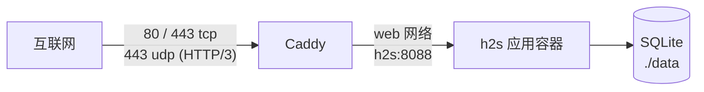

# 部署与反向代理

本文说明标准 Docker 部署的外围部分：容器拓扑、DNS 与端口、Caddy 配置、证书、日志、
客户端 IP 与限流，以及改用其它反向代理时要注意的事。应用本身的启动步骤见
[README.md](README.md) 的 Quick start；架构与故障边界见 [ARCHITECTURE.md](ARCHITECTURE.md)。

本文描述仓库里的 `docker-compose.yml`、`docker-compose.local.yml` 与 `Caddyfile`，
不代表任何具体服务器的实际状态。

## 1. 标准拓扑

标准部署由两个容器组成：



- **只有 Caddy 对外发布端口。** `h2s` 使用 compose 的 `expose`，端口只在 `web`
  网络内可见，宿主机和公网都连不到它。
- Caddy 终止 TLS，把请求反代到 `h2s:8088`，并负责 HTTP → HTTPS 跳转与证书续期。
- 两个容器在同一个 compose 网络 `web` 上，`h2s` 的容器名即主机名。

本地试运行使用 `docker-compose.local.yml` 覆盖层，不启动 Caddy，见 §8。

## 2. 启动前准备

1. **域名先解析。** 在启动前把 `Caddyfile` 中的域名 A/AAAA 记录指向服务器。Caddy
   在首次启动时就会申请证书；域名还没解析时申请会失败。
2. **防火墙放行**：

   | 端口 | 协议 | 用途 |
   |---|---|---|
   | 80 | TCP | HTTP → HTTPS 跳转；ACME HTTP-01 回退 |
   | 443 | TCP | HTTPS；ACME TLS-ALPN-01 |
   | 443 | UDP | HTTP/3 |

3. **宿主机 80 / 443 必须空闲。** 已有 nginx、Apache 或其它服务占用这两个端口时，
   Caddy 无法启动。这种情况应改用 §7 的方式。
4. **没有域名时不要走这条路径**，直接用 §8 的本地覆盖层。

## 3. Caddyfile

仓库根目录的 `Caddyfile` 是完整配置，逐项含义：

| 配置 | 作用 |
|---|---|
| `your.domain.com { … }` | 站点地址。容器启动前的预检会拒绝仍含占位域名的文件 |
| `reverse_proxy h2s:8088` | 转发到应用容器；自动处理 WebSocket 与 SSE |
| `request_body { max_size 20MB }` | 请求体上限，与应用 `MAX_CONTENT_LENGTH`（20 MB）对齐；需要 Caddy 2.10+ |
| `header { … }` | `X-Frame-Options DENY`、`X-Content-Type-Options nosniff`、`Referrer-Policy`，并移除 `Server` 响应头 |
| `log { … }` | 访问日志写入 `/var/log/caddy/access.log`，JSON 格式，10 MiB 轮转、保留 7 份 / 30 天 |

镜像使用的是 `caddy:2-alpine`。这是浮动 tag，重建时可能升级到新的 2.x；需要可复现
部署时把它固定到具体版本，并确认所用版本支持 `request_body`（2.10+）。

## 4. 证书与数据卷

Caddy 的两个卷必须保留：

| 卷 | 内容 |
|---|---|
| `caddy_data` | 证书、私钥、ACME 账户 |
| `caddy_config` | Caddy 运行时自动生成的配置 |

- 删除 `caddy_data` 会导致重新签发证书。证书本身可以重建，但短时间内反复签发可能
  触发 CA 的速率限制。升级或重建容器不会删除具名卷。
- 证书不包含应用数据；备份仍以 `data/listings.db` 与 `.env` 为准，见 README 的
  「Upgrading and backups」。
- 默认使用 Caddy 的自动 HTTPS。若 80 端口被封、或域名挂在会终止 TLS 的 CDN 后面，
  签发可能失败；需要改用 DNS challenge，仓库没有预置该配置。

## 5. 客户端 IP 与限流：`TRUSTED_PROXY_HOPS`

应用用 `request.remote_addr` 做 IP 限流（登录、注册、访客接口、崩溃上传等）。经过
Caddy 后，该字段默认是 **Caddy 容器的地址**，不是真实客户端。`TRUSTED_PROXY_HOPS`
告诉应用信任 `X-Forwarded-For` 的最后几跳：

| 部署形态 | 取值 |
|---|---|
| Caddy → h2s（标准部署） | `1` |
| 直接暴露 `h2s:8088`，没有反代 | `0` |
| Cloudflare → Caddy → h2s | `2` |
| 本地覆盖层（无 Caddy） | `0`（覆盖层已设置） |

标准 `docker-compose.yml` 通过 `TRUSTED_PROXY_HOPS=${TRUSTED_PROXY_HOPS:-1}` 默认取
`1`。需要改时在 `.env` 里写同名键，compose 会读取并传给容器；容器环境变量优先于
容器内 `.env` 的加载值。

**取值错误的后果**：设成 `0`（或没设）时，所有请求看起来来自同一个代理地址，限流
退化成一个全局计数桶——既防不住换 IP 的攻击者，一次注册失败就可能占满全站配额；
访问日志里的客户端 IP 也全是代理地址。设得过大则会把客户端可伪造的
`X-Forwarded-For` 前缀当成真实来源。

## 6. 日志

| 日志 | 位置 | 说明 |
|---|---|---|
| Caddy 访问日志 | 宿主机 `./logs/caddy/access.log` | JSON；10 MiB 轮转，保留 7 份 / 30 天 |
| 应用与 monitor | 宿主机 `./logs/`、`docker compose logs` | 面板 `/logs` 可在线查看与过滤 |
| Caddy 自身 | `docker compose logs caddy` | 证书申请、配置错误、启动失败 |

常用：

```bash
docker compose logs -f caddy
docker compose logs -f h2s
tail -f logs/caddy/access.log
```

## 7. 改用其它反向代理

如果已有 nginx、Traefik 或云负载均衡，可以不使用仓库里的 Caddy：

1. 从 `docker-compose.yml` 移除 `caddy` 服务及 `web` 网络（或只启动 `h2s`：
   `docker compose up -d h2s`）。
2. 给 `h2s` 增加端口映射。推荐只绑回环，由宿主机上的反代访问：
   ```yaml
   ports:
     - "127.0.0.1:8088:8088"
   ```
3. 在自有反代上终止 TLS 并转发到 `127.0.0.1:8088`，同时：
   - 设置 `X-Forwarded-For` 与 `X-Forwarded-Proto`；
   - 把 `TRUSTED_PROXY_HOPS` 设为实际的**可信**代理跳数；
   - 请求体上限设为 20 MB，与应用一致；
   - 对 `/notifications/stream` 关闭响应缓冲，否则 SSE 会被攒住。
4. 把 `.env` 中的 `SESSION_COOKIE_SECURE` 设为 `true`（HTTPS 部署必须）。
5. **处理启动预检。** `docker-compose.yml` 会把 `./Caddyfile` 挂到
   `/app/Caddyfile.check`，entrypoint 见到占位域名就拒绝启动。不用 Caddy 时，可以：
   - 仍然把 `Caddyfile` 的占位域名改掉（最简单），或
   - 删除该 volume 挂载。

   `H2S_SKIP_PREFLIGHT=1` 只应在隔离/本地网络使用——它会同时跳过
   `WEB_PASSWORD` 空值检查。

## 8. 本地与隔离模式

```bash
docker compose -f docker-compose.yml -f docker-compose.local.yml up -d h2s
```

覆盖层与标准部署的差异：

- 不启动 Caddy，不占用 80 / 443；
- 端口只发布到宿主机回环 `127.0.0.1:8088`；
- 跳过 entrypoint 的安全预检（`H2S_SKIP_PREFLIGHT=1`）；
- `TRUSTED_PROXY_HOPS=0`，因为没有反代。

该模式下面板是**明文 HTTP，且可能没有密码**。不要改绑 `0.0.0.0`，也不要用于公网主机。

## 9. 排障

| 现象 | 先检查 |
|---|---|
| 证书没有签发 | 域名是否已在启动前解析到本机；80 / 443 是否可达；`docker compose logs caddy` 里的 ACME 错误 |
| 访问域名返回 502 | `h2s` 是否在运行、healthcheck 是否通过；`docker compose logs h2s` |
| 上传请求返回 413 | Caddy 的 `request_body max_size` 与 `MAX_CONTENT_LENGTH` 是否一致 |
| 所有用户的限流像同一个桶 | `TRUSTED_PROXY_HOPS` 是否为 `0`；看 Caddy 日志里的客户端 IP |
| SSE 不推送或延迟很久 | 自有反代是否缓冲了 `/notifications/stream`；Caddy 默认不缓冲 |
| Caddy 启动报端口占用 | 宿主机 80 / 443 是否被其它服务（nginx、Apache、旧 Caddy）占用 |
| 容器启动即退出并打印 `FATAL` | 预检未通过：`Caddyfile` 仍含 `your.domain.com`，或 `WEB_PASSWORD` 为空 |

## 10. 速查

| 项 | 值 |
|---|---|
| 对外端口 | 80/tcp、443/tcp、443/udp |
| 应用端口 | `h2s:8088`（仅 compose 网络内） |
| Caddy 配置 | 仓库根目录 `Caddyfile` |
| Caddy 证书卷 | `caddy_data`、`caddy_config` |
| Caddy 访问日志 | `./logs/caddy/access.log` |
| 请求体上限 | 20 MB（Caddy 与 Flask 两侧） |
| 客户端 IP | `TRUSTED_PROXY_HOPS`，标准部署为 `1` |
| 本地模式 | `docker-compose.local.yml` |
